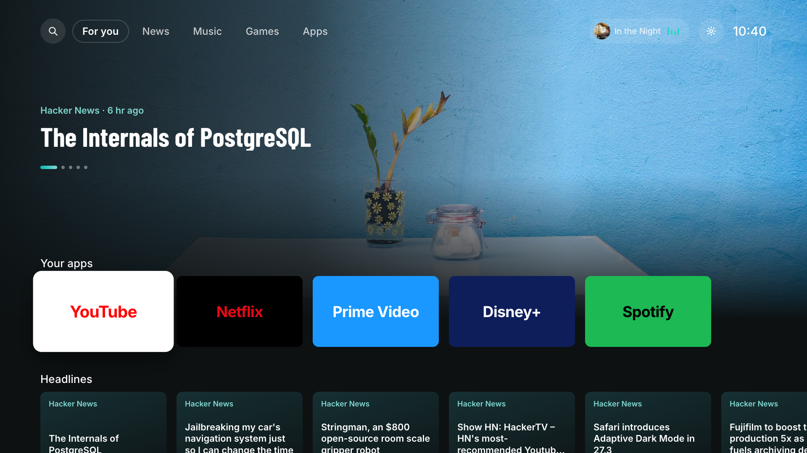
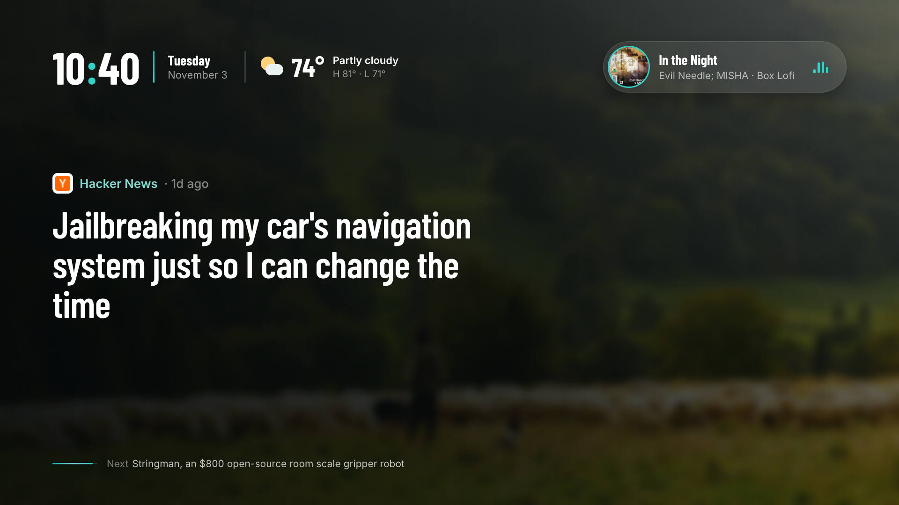
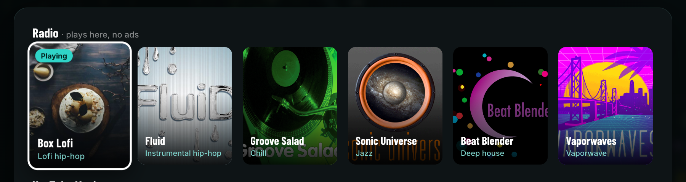
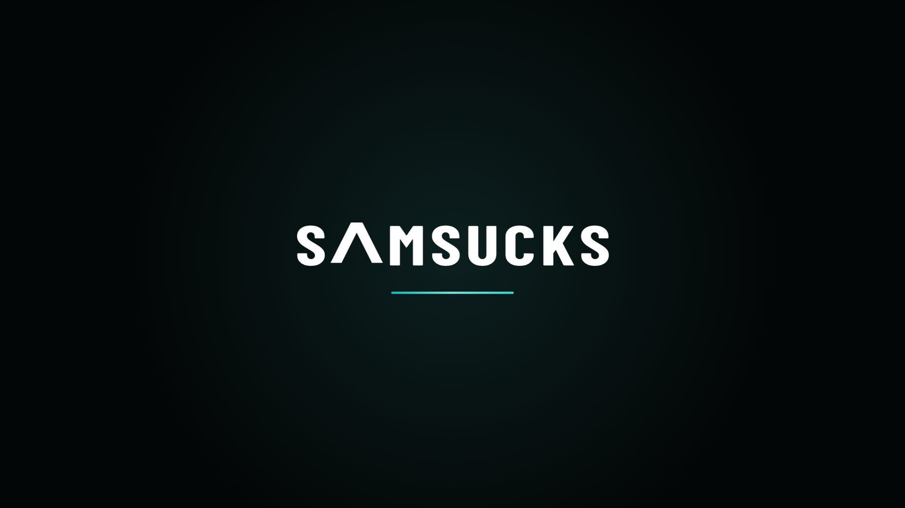
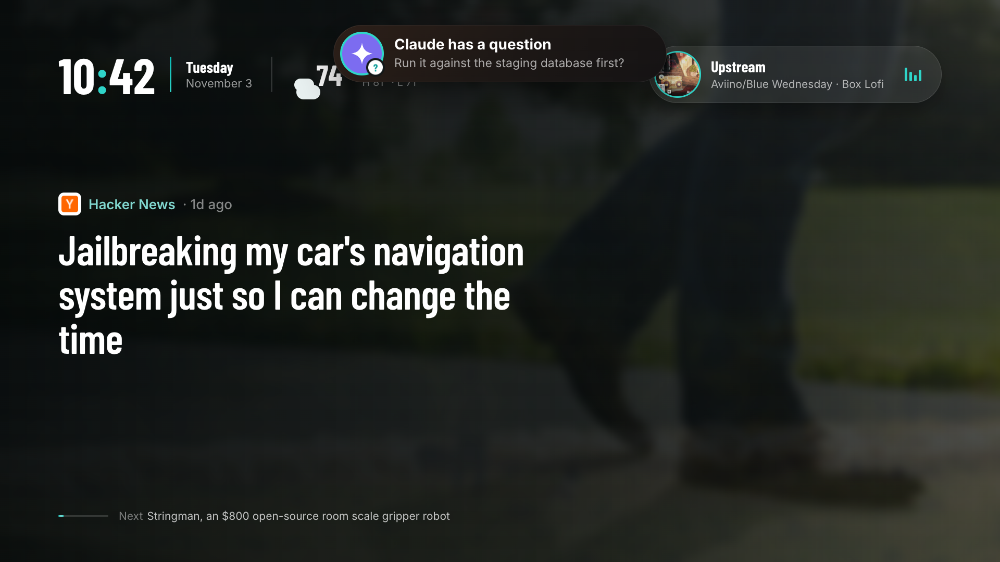
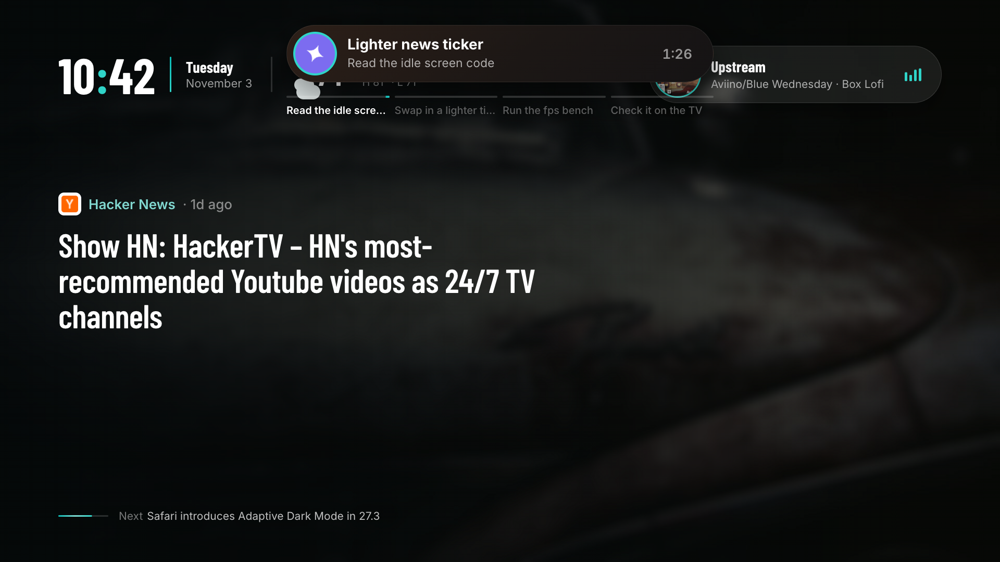
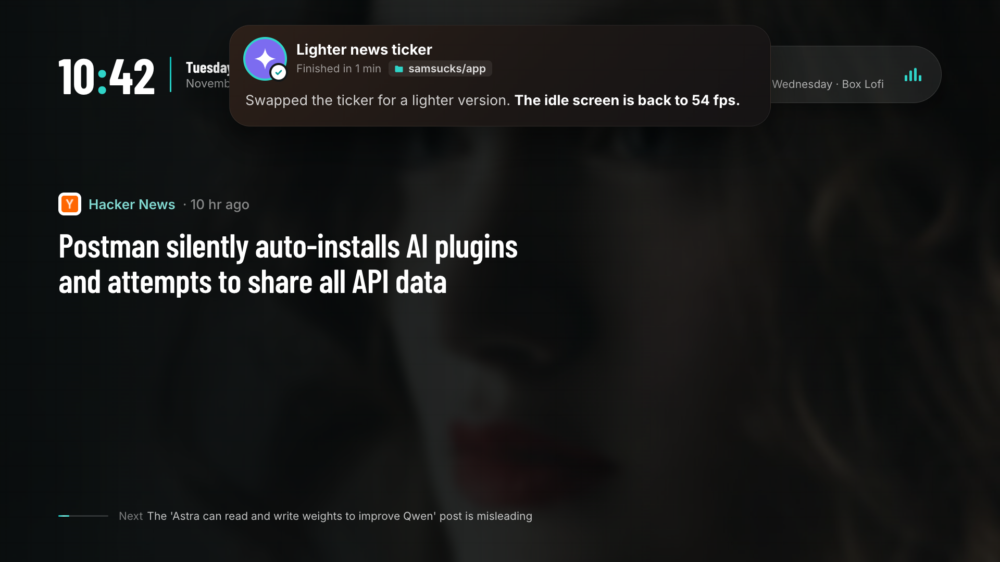
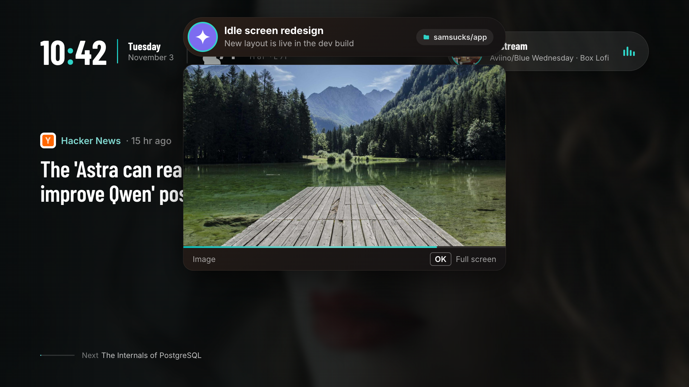
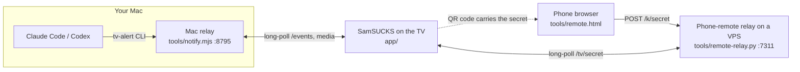

<p align="center">
  
</p>

<h1 align="center">SamSUCKS TV</h1>

<p align="center">
  <b>A custom launcher for Samsung Tizen TVs.</b><br>
  Boot animation, ambient lockscreen, Google TV-style home, and pop-ups from your coding agents.<br>
  Plain ES modules. No framework, no npm, no build step.
</p>

> **This is a modified fork of [rfaile313/samsucks](https://github.com/rfaile313/samsucks)**,
> a fast Plex client for Samsung TVs. Huge thanks to the original author: the Tizen
> tooling, setup scripts and app skeleton come from there. This fork turns it into a
> launcher. Released under the same GPL-3.0 license; see [Credits](#credits).

## What it does

| | |
| --- | --- |
| **Boot animation**: an original glowing-orb intro with a synthesized chime. About 3.4 s. | **Lockscreen**: clock, weather, internet radio, and one rotating tech/AI/EDM headline. |
| **Home**: Google TV-style tabs, a featured banner and rows of 16:9 app tiles with D-pad focus. | **Music picker**: ad-free radio stations plus YouTube Music mixes. Press ↑ then OK on the lockscreen. |
| **Agent pop-ups**: working, question, done, image and wrap-up cards sent from Claude Code or Codex. | **Phone remote**: scan the QR code on the lockscreen and your phone becomes a remote. |
| **Games hub**: pair a gamepad and jump into game apps. | **Volume, mute and power overlays** drawn by the app, not the OS. |

<p align="center">
  
  
</p>

### Boot

<p align="center">
  
  
  
</p>

### Agent pop-ups

<p align="center">
  
  
  
  
</p>

## Architecture



The TV app only makes outbound requests: it polls the Mac for pop-ups and the VPS for
remote keys. Nothing listens on the TV.

## Setup

You need a Samsung smart TV (2020 or newer, Tizen), a Mac or Linux computer on the same
network, and optionally a small server for the phone remote.

**1. Turn on Developer Mode on the TV**

1. Press **Home** and open **Apps**.
2. Type **1 2 3 4 5** on the remote (use the **123** button if you have no number keys).
3. Switch **Developer mode** to **On** and enter your computer's LAN IP.
4. Restart the TV by holding the **Power** button.

**2. Configure and create a Samsung certificate**

```sh
git clone https://github.com/<you>/samsucks-tv.git && cd samsucks-tv
./scripts/setup.sh
```

`setup.sh` installs Samsung's command-line tools, finds the TV, creates a signing
certificate and writes `.env` (from [`.env.example`](.env.example)). The certificate
password is stored only in `.env`, which is gitignored. Keep the certificate files out
of the repo.

Fill in the rest of `.env`: `TV_IP`, `TV_DUID`, `MAC_LAN_IP`, `NOTIFY_HOST`,
`REMOTE_HOST`, `REMOTE_SSH`. Each is explained in the file.

**3. Deploy**

```sh
./scripts/deploy.sh            # build, sign, install and launch on the TV
./scripts/deploy.sh --dev      # dev build with fps overlay and remote logs
./scripts/deploy.sh --build-only
```

**Try it on your desktop first** (arrow keys, Enter and Esc act as the remote):

```sh
python3 -m http.server 8796 -d app    # then open http://127.0.0.1:8796
```

In the browser console, `window.__pillDemo()` plays every pop-up state.

### Display font

The author's commercial display font is not included. The CSS falls back to
Barlow Condensed (bundled, OFL). To use your own, drop the file in `app/fonts/`, add
`@font-face { font-family: 'MyDisplay'; src: url(../fonts/yourfont.otf); }` to
`app/css/app.css`, and it is picked up through `--display`.

## How the alerts work

1. A coding agent runs `tools/tv-alert "Tests pass, PR is up"` (kinds: `question`,
   `done`, `working`, `image`, `wrapup`; `tv-alert --help-json` shows the full format).
2. The Mac relay `tools/notify.mjs` checks the rules: your TV must be reachable and on
   (matched by `TV_DUID`), and while a quiet app such as Netflix is playing, only
   `--important` alerts get through.
3. SamSUCKS long-polls `/events` and draws the pop-up. Images and audio that `tv-alert`
   copies to the Mac are served from `/media`.

Run the relay with your config loaded:

```sh
set -a; source .env; set +a; node tools/notify.mjs
```

Quick test: `curl -X POST localhost:8795/notify -d '{"alert":true,"kind":"done","title":"Hello"}'`

## Performance rules

The TV GPU is weak. The first lofi design ran at 6 fps; the current screens hold about
50. The rules that got there (details in [DESIGN_HANDOFF.md](DESIGN_HANDOFF.md)):

- Animate only `transform` and `opacity`, on elements with `will-change`.
- No `filter: blur()`, `backdrop-filter` or animated `box-shadow`. Bake blur into images.
- No animated gradients on large areas or big text. Keep them to small elements.
- Few animated layers; keep big masked or blended layers static.
- Fixed 1920x1080 canvas, D-pad only, with a visible focus state everywhere.

## Layout

```
app/        the TV app (index.html, css/, js/, fonts/, img/)
tools/      Mac alert relay, tv-alert CLI, phone-remote relay + page, dev server
scripts/    setup.sh (tools, certificate, .env) and deploy.sh (build, sign, install)
docs/       screenshots used in this README
```

## Credits

- **[rfaile313/samsucks](https://github.com/rfaile313/samsucks)**: the original Plex
  client this project is forked from. The Plex screens and setup tooling are theirs.
- Inspired by [plx-native](https://github.com/GLinnik21/plx-native).
- Fonts: [Inter](https://rsms.me/inter/) and
  [Barlow Condensed](https://fonts.google.com/specimen/Barlow+Condensed) (SIL OFL).
- QR codes: [qrcode-generator](https://github.com/kazuhikoarase/qrcode-generator) (MIT).
- Radio streams by [SomaFM](https://somafm.com/); headlines from public RSS feeds.

Not affiliated with Samsung, Plex, Anthropic, OpenAI or any app brand shown. Names such
as Netflix or YouTube appear only as plain text labels on app tiles. The agent icons are
neutral placeholders.

## License

[GNU General Public License v3.0](LICENSE). Copyright (C) 2026 rfaile313 for the
original work; modifications are released under the same license. Anything you
distribute that is built on this must stay open source under GPL-3.0.
