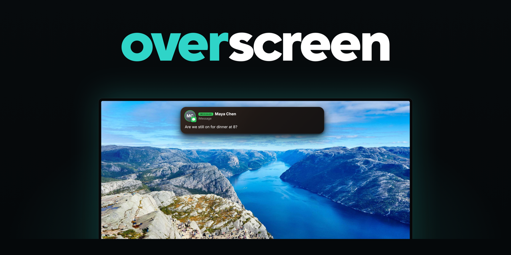
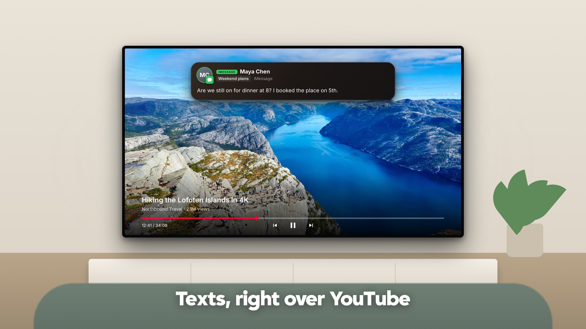
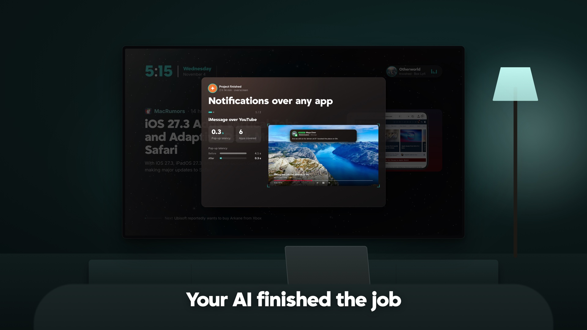

<p align="center"></p>

<p align="center">
  
  
  
</p>

<p align="center"><b>Your Mac and iPhone notifications, on top of whatever's playing on your Samsung TV.</b><br>
iMessages, FaceTime calls, Discord and your AI coding agents, drawn right over Hulu, the YouTube app, your console or live TV.</p>

<p align="center"><b>All you need is a Mac laptop with Claude, on the same Wi-Fi as your TV.</b><br>
No cables, no USB, no extra box, no root.</p>

<table>
  <tr>
    <td width="50%"></td>
    <td width="50%"></td>
  </tr>
  <tr>
    <td align="center"><b>Texts, right over YouTube</b></td>
    <td align="center"><b>Your AI finished the job</b></td>
  </tr>
</table>

> Samsung's developer FAQ says *"overlay applications are not supported"* on its TVs.
> Overscreen does it anyway, with public Tizen APIs on a stock 2025 TV in Developer Mode.

---

## The trick

Tizen TV **web** apps can't draw over another app. The most they get is Samsung's plain grey text
banner. A small **native Tizen .NET (NUI) app** can do more:
1. It opens a second window of type `WindowType.Notification`.
2. It makes that window transparent and **non-focusable**.
3. It sets the window's notification level.

The TV then draws that window **above the app that's playing**, and the remote keeps controlling the
app underneath.

```csharp
var win = new Window("overlay", new Rectangle(x, y, w, h), true);
win.Type = WindowType.Notification;           // drawn above other apps
win.SetTransparency(true);
win.SetOpaqueState(false);
win.SetAcceptFocus(false);                    // the remote keeps driving Hulu / YouTube
win.SetNotificationLevel(NotificationLevel.Base);
```

**Tested** on a Samsung UN50U8000F (2025, Tizen 9.0), over **Hulu** and the **native YouTube app**:
- video and audio keep playing;
- the remote still pauses and seeks;
- there's no flash. A WebView inside that window flashes white when it appears; plain native views don't.

**Not tested yet:** Netflix, Disney+, Prime Video. Reports welcome.

## How it works

```text
           MAC                                              TV
 ┌───────────────────────────┐                 ┌──────────────────────────────────┐
 │ Claude Code / Codex hooks │                 │ Overscreen web app               │
 │ iMessage · FaceTime ·     │ ──► notify.mjs ─┼─► lockscreen, home, YouTube mode,│
 │ Discord  (tvmessages)     │     (the relay) │   HDMI / live TV (pills in-app)  │
 └───────────────────────────┘        │        │                                  │
                                      ▼        │ tvoverlay/ (native NUI window)   │
                             pillshot (WebKit) ┼─► the same pill, OVER Hulu,      │
                             pill → PNG        │   YouTube, anything              │
                                               └──────────────────────────────────┘
```

- **One design.** The pills are written once, in HTML/CSS (`app/css/popups.css`, `app/js/ui/pill.js`).
- **Inside Overscreen** they render live.
- **Over other apps** the Mac renders the same pill to a transparent PNG (`tools/pillshot.swift`), and the native window shows it. The design stays pixel-identical without being rewritten in C#.
- **Fallback:** if the overlay isn't running, you get Samsung's text banner.

## Notifications

| | Source | What pops up |
|:-:|---|---|
|  | **Claude Code** | Working (with a live task title), finished (says *what* finished), questions, approvals, corrections, additions, image previews, wrap-ups, spoken updates |
|  | **Codex** | The same set. Starts, finishes and approvals come from Codex's hooks; the rest via `tv-alert` |
|  | **iMessage / texts** | Sender's photo and name, group name, the message |
|  | **FaceTime** | Incoming calls with the caller's photo. They ring through even on "quiet" apps |
|  | **Discord** | Sender, server and channel, message |

**Pill types:**

`QUESTION` · `WORKING` · `CORRECTION` · `ADDITION` · `DONE` · `PREVIEW` · `WRAP-UP` · `VOICE` · `iMESSAGE` · `FACETIME` · `DISCORD`

When several agents are working, each one docks as a small icon in the corner with a short task label.

**Where they show:**

| On screen | What you get |
|---|---|
| Overscreen itself (lockscreen, home, YouTube mode, HDMI / live TV) | The full pill, with sound |
| Another app (Hulu, the YouTube app, …) | The same pill, through the native overlay |
| Netflix or Hulu playing | Only the important ones: questions, approvals, calls |

## Also in the box

- **Lockscreen:**
  - a starfield with a drifting nebula, a big clock and the music that's playing;
  - rotating news with photos and real key points. It skips clickbait and repeats, and looks back further late at night.
- **Home and music:**
  - a Google TV-style home screen;
  - built-in radio;
  - YouTube mixes, played through the Mac or opened in the YouTube app.
- **YouTube mode:** YouTube's own TV site runs inside Overscreen, so pills sit on top. It uses Developer Mode's debug launch, the same trick as TizenBrew.
- **HDMI / live TV inside Overscreen** via `tvwindow`, so consoles and cable boxes get real overlays too.
- **Polite rules:**
  - only on your home Wi-Fi, and only while the TV is on;
  - no voice while you're sitting at your Mac;
  - spoken updates pause the video, then resume it.

<details>
<summary><b>News sources</b> (50 feeds, 10 topics)</summary>

<br>

Topics can be switched on or off in Settings. Every story needs a photo. Clickbait, deals, listicles,
first-person takes and repeats are filtered out, and the same event from several outlets is merged
into one story.

| Topic | Sources |
|---|---|
| **Tech** |  The Verge ·  Ars Technica ·  Engadget ·  TechCrunch ·  Wired ·  9to5Mac ·  MacRumors |
| **AI** |  The Verge ·  Ars Technica ·  TechCrunch ·  MIT Tech Review |
| **Gaming** |  PC Gamer ·  IGN ·  GameSpot ·  Eurogamer ·  Polygon ·  Rock Paper Shotgun ·  The Verge |
| **Politics**<br><sub>multi-outlet, with a Left / Center / Right bar</sub> |  NPR ·  The Hill ·  Axios ·  BBC ·  Politico ·  CBS ·  NBC News ·  NY Post ·  National Review ·  Vox ·  Breitbart ·  The Dispatch ·  Washington Times |
| **Culture** |  Variety ·  Rolling Stone |
| **Offbeat** |  UPI Odd News ·  Sky News ·  Good News Network |
| **Bass & EDM** |  UKF ·  EDM Identity ·  EDMTunes ·  Dancing Astronaut ·  EDM Sauce |
| **World** · **Business** · **Science**<br><sub>off by default</sub> |  BBC ·  NPR ·  CBS ·  NBC News ·  CNBC |

If none of the feeds load, it falls back to Hacker News.

</details>

## Requirements

Nothing gets plugged in. The Mac and the TV only need to be on the same Wi-Fi.

- **A Samsung Tizen TV in Developer Mode**, with your Mac set as the host. Tested on Tizen 9.0 (2025).
- **Tizen Studio** with a Samsung certificate profile. The overlay needs the `window.priority.set` privilege, which this certificate accepted on the test TV.
- **A Mac** with Node 20+, the Xcode command-line tools (for Swift), and the .NET 6 Tizen workload (for `tvoverlay/`).
- **For iMessage, FaceTime and Discord:** in System Settings, give `tvmessages` **Full Disk Access** and **Contacts**.

## Setup

**1. Configure.** Copy the example settings, then fill in your TV's IP, your Mac's LAN IP (`MAC_LAN_IP`), the TV's DUID (`TV_DUID`) and your signing profile:

```bash
cp .env.example .env
```

**2. Install the TV app.** This builds, signs, installs and launches it over Wi-Fi:

```bash
./scripts/deploy.sh
```

**3. Install the overlay.** Build, sign with your Samsung profile, then install:

```bash
cd tvoverlay
dotnet build -c Release
tizen package -t tpk -s <profile> -- bin/Release/net6.0-tizen8.0/*.tpk
sdb install bin/Release/net6.0-tizen8.0/*.tpk
```

**4. Set up the Mac side.**
- Run `tools/notify.mjs` as a LaunchAgent.
- Build `tools/pillshot.swift`, `tools/tvmessages.swift` and `tools/tasktitle.swift` with `swiftc -O`.
- Run `node tools/overlay/build.mjs`.

**5. Hook up your agents.**
- Point Claude Code's `UserPromptSubmit`, `Stop` and `Notification` hooks, and Codex's, at `POST http://127.0.0.1:8795/notify`.
- Agents can also call `tools/tv-alert`.

> Brand icons (Claude, ChatGPT, Messages, FaceTime, Discord) aren't included; generic glyphs ship
> instead, and you can drop your own into `app/img/brand/`. The display font (Grift) is commercial,
> so it falls back to Barlow and Inter.

## What it won't do

- **No root, no exploits,** and no getting around YouTube's bot checks. Mixes use stock `yt-dlp`, and the YouTube app is opened over DIAL.
- **It never reads other apps' content.** The overlay only draws on top.

## Credits

- Forked from [rfaile313/samsucks](https://github.com/rfaile313/samsucks), a Plex client for Samsung TVs.
- The debug-launch trick was inspired by [TizenBrew](https://github.com/reisxd/TizenBrew) and [TizenTube](https://github.com/reisxd/TizenTube).
- Lockscreen nebula images are from ESA/Hubble, under CC BY 4.0. See `app/media/space/CREDITS.txt`.
